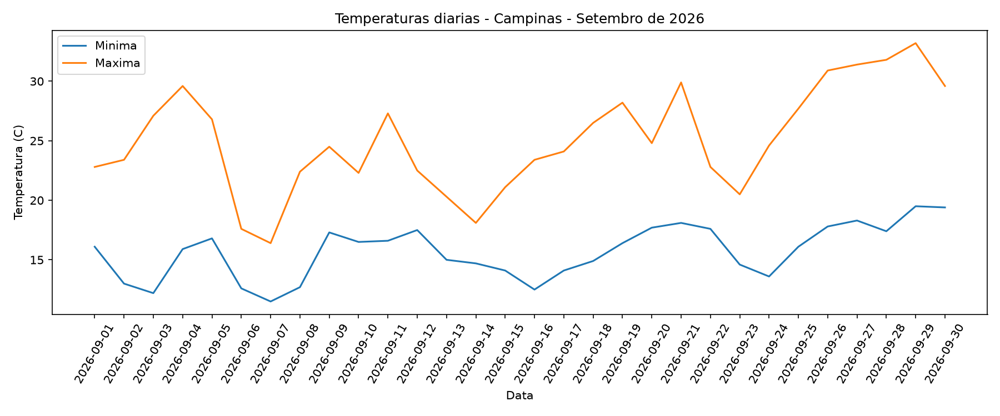
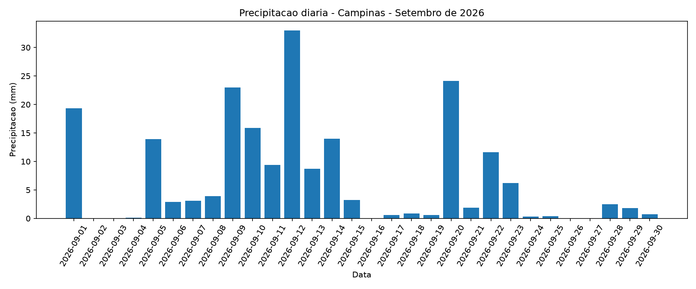

# Observatório Climático de Campinas (SP)

## Projeto Integrador — Ciência de Dados

### 1. Apresentação
Este projeto tem como objetivo analisar dados climáticos do município de Campinas (SP), utilizando ferramentas de Ciência de Dados para organizar, armazenar, consultar e visualizar informações sobre temperaturas e precipitação.

O estudo considera 30 registros diários referentes a setembro de 2026.

### 2. Objetivos
- Coletar e organizar dados climáticos.
- Armazenar as informações em um banco de dados.
- Realizar consultas utilizando SQL.
- Identificar variações de temperatura e precipitação.
- Apresentar os resultados por meio de gráficos.

### 3. Tecnologias utilizadas
- **Python:** processamento e automação.
- **Pandas:** manipulação dos dados.
- **DuckDB:** armazenamento e consultas.
- **SQL:** análise das informações.
- **Matplotlib:** criação dos gráficos.
- **GitHub:** documentação e disponibilização do projeto.

### 4. Metodologia
O projeto foi desenvolvido em etapas: coleta de dados, organização dos registros, armazenamento no DuckDB, consultas SQL e elaboração de gráficos.

### 5. Resultados
A análise dos 30 registros apresentou:

- Temperatura mínima média: **15,68 °C**
- Temperatura máxima média: **25,05 °C**
- Precipitação acumulada: **202,0 mm**
- Maior temperatura máxima registrada: **33,2 °C**, em 29/09/2026.
- Maior precipitação diária registrada: **33,0 mm**, em 12/09/2026.

### 6. Visualização dos dados

**Gráfico de temperaturas**



**Gráfico de precipitação**



### 7. Arquivos do projeto
- `coleta.py` — coleta dos dados.
- `banco.py` — armazenamento no banco de dados.
- `consultas.sql` — consultas SQL.
- `graficos.py` — geração dos gráficos.
- `requirements.txt` — dependências do projeto.
- 9. Análise da amplitude térmica

A amplitude térmica diária corresponde à diferença entre a temperatura máxima e a temperatura mínima de cada dia.

A análise dos registros de setembro de 2026 permite observar variações dessa amplitude ao longo do mês, evidenciando diferenças nas condições térmicas diárias.

10. Relevância para a comunidade

O Observatório Climático de Campinas busca apresentar informações meteorológicas históricas de maneira simples e acessível.

Os gráficos e indicadores permitem que os moradores compreendam melhor as variações de temperatura e precipitação registradas no período.

Essas informações têm caráter educativo e não representam previsões meteorológicas.

11. Limitações do estudo

Os dados utilizados são provenientes de uma fonte meteorológica que pode combinar informações modeladas e de reanálise, não correspondendo necessariamente a medições realizadas por uma estação local.

Além disso, o período analisado compreende apenas 30 dias, sendo insuficiente para identificar tendências climáticas de longo prazo ou estabelecer conclusões sobre mudanças climáticas.

### 8. Conclusão
O projeto demonstra a aplicação de ferramentas de Ciência de Dados na análise de informações climáticas, permitindo identificar variações de temperatura e precipitação no período estudado.

Os resultados podem servir como base para estudos posteriores e para ampliar a compreensão das condições climáticas de Campinas (SP).
## 9. Como executar o projeto

É necessário ter Python instalado no computador.

1. Baixe ou clone este repositório.
2. Abra o terminal na pasta do projeto.
3. Instale as dependências:

```bash
pip install -r requirements.txt
```

4. Execute os scripts na seguinte ordem:

```bash
python coleta.py
python banco.py
python graficos.py
```

O script de coleta obtém os dados históricos, o script do banco organiza os registros no DuckDB e o script de gráficos gera as visualizações.

As consultas SQL utilizadas na análise estão disponíveis no arquivo `consultas.sql`.

**Observação:** Os dados são históricos e não representam uma previsão meteorológica.
